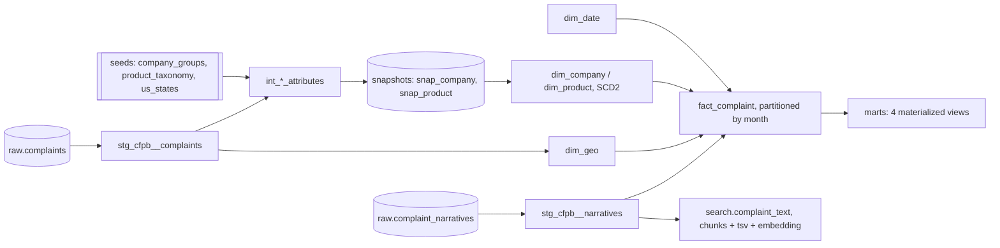

# complaint-warehouse

A PostgreSQL + pgvector warehouse over the CFPB Consumer Complaint Database that supports both analytics and hybrid (keyword + semantic) search.

> Work in progress. I am building this in phases; see `CHANGELOG.md` for what has landed.

## Quickstart (current state)

```bash
cp .env.example .env
make up                       # or: docker compose up -d --build --wait
curl localhost:8000/health    # {"status":"ok", "database": {"postgres": "16.x", "pgvector": "0.8.0"}}
```

Local development:

```bash
python -m venv .venv && source .venv/bin/activate
make install                  # pip install -e ".[dev]" + pre-commit hooks
make lint test
```

## Ingestion

I load from three official CFPB sources. The CFPB stopped publishing consumer narratives on
2026-08-14, so the narratives come from its FOIA archive (see
[ADR 0005](docs/adr/0005-narratives-from-cfpb-foia-archive.md)).

| Command | Source | Lands in |
|---|---|---|
| `make ingest` | Search API, incremental from the watermark (30-day lookback) | `raw.complaints` |
| `make ingest-bulk ARGS="--start 2023-01-01"` | `complaints.csv.zip` backfill | `raw.complaints` |
| `make ingest-narratives ARGS="--start 2025-01-01"` | FOIA Narratives Archive | `raw.complaint_narratives` |
| `make ingest-status` | watermark, row counts, last 10 runs | - |

Every load is idempotent. Rows are upserted by `complaint_id` and only rewritten when a hash
of their business fields changes, so rerunning a load writes nothing.

## Warehouse (dbt)

`make dbt` seeds reference data, takes SCD2 snapshots, builds every model and runs the tests.
`make dbt-docs` serves the lineage graph and column docs on http://localhost:8081.



| Layer | Schema | Models |
|---|---|---|
| Staging | `staging` | `stg_cfpb__complaints`, `stg_cfpb__narratives` (views) |
| Star schema | `warehouse` | `fact_complaint` (monthly range partitions), `dim_company` and `dim_product` (SCD Type 2), `dim_date`, `dim_geo` |
| Search | `search` | `complaint_text`: 200-word overlapping chunks, `tsvector`, `vector(768)` |
| Marts | `marts` | `mv_company_monthly`, `mv_product_monthly`, `mv_state_monthly`, `mv_daily_volume` |

## Embeddings

`python -m complaint_warehouse.embed run` fills `search.complaint_text.embedding` with
`BAAI/bge-base-en-v1.5` vectors (768-d, L2-normalised). The job is resumable: each batch's
vectors and its checkpoint (`ops.embedding_checkpoints`) commit in one transaction, so a crash
or Ctrl+C loses at most one batch and a rerun carries on from the last committed key. Writes
run on a separate thread, overlapped with encoding. Vectors only land if the chunk text is
unchanged since it was read, and the job refuses to mix models in one column.

```bash
make embed GPU=1 ARGS="--limit 20000"   # time a sample on the GPU build
make embed GPU=1                        # embed everything pending
make embed-status                       # counts per model + checkpoint
```

On my RTX 5050 laptop GPU it runs at about 360 chunks/s and is GPU-bound. The model choice
and the measurements are in [ADR 0006](docs/adr/0006-embedding-model-and-batch-job.md).

## Hybrid search

`search.hybrid_search` fuses a full-text arm (`ts_rank_cd` over a GIN index) and a semantic
arm (pgvector cosine distance) with Reciprocal Rank Fusion, in one inlinable SQL function
made of CTEs. FastAPI exposes it at `GET /search`:

```bash
curl -G localhost:8000/search   --data-urlencode "q=bank charged me twice for one purchase"   --data-urlencode "mode=hybrid" --data-urlencode "k=5"   --data-urlencode "date_from=2025-03-01" --data-urlencode "product_family=Credit cards"
```

`mode` is `hybrid`, `keyword` or `semantic`. A mode sets the arm weights, and a weight of 0
means the arm is never executed. Filters (`date_from`, `date_to`, `product_family`,
`company`, `state`) apply inside each arm before its LIMIT. Each hit carries both arm ranks,
the cosine similarity, its complaint attributes and a highlighted snippet of its best chunk.
The design and the query plans behind it are in
[ADR 0002](docs/adr/0002-hybrid-search-rrf.md).

`keyword_match=all` (the default) requires every query term in the keyword arm; `any` ORs
them. The evaluation below showed that OR makes hybrid results worse, so it is opt-in.

Without a vector index, an unfiltered semantic or hybrid search is an exact scan of 5.6M
vectors (about 100 s) and returns 504 at the 30 s statement timeout. Keyword search (30 ms
warm) and filtered hybrid search (about 1 s for a month and a product family, 1.6 s for a
whole year) are interactive. The index study below picks the HNSW parameters; building that
index over the full corpus needs more memory than this laptop's Docker VM (ADR 0004).

## Benchmarks

`make bench ARGS=prepare|index|gin|quality|analytics` writes JSON results and generated
Markdown to [`bench/results/`](bench/results/). Method notes are in
[`bench/README.md`](bench/README.md). Headline numbers:

- **Vector indexes** (500k-chunk sample, exact top-100 ground truth): HNSW on `halfvec`,
  m = 32, ef_construction = 128, reaches recall@100 of 0.904 at 17.5 ms p50 with
  ef_search = 200. The float32 index is 1.6 GB; this one is 858 MB. IVFFlat needs 34–66 ms
  for about 0.9 recall@10, where HNSW needs 10 ms. Details:
  [index study](bench/results/index_study.md) and
  [ADR 0004](docs/adr/0004-hnsw-parameters.md).
- **Search quality** (52 queries labelled by CFPB issue and sub-issue, 2019): nDCG@10 is
  0.149 for keyword (AND), 0.564 for semantic and 0.563 for hybrid. Hybrid has the best
  MRR, 0.80. OR matching drops hybrid to 0.442. Details:
  [search quality](bench/results/search_quality.md) and
  [ADR 0002](docs/adr/0002-hybrid-search-rrf.md).
- **Analytics library** ([`sql/analytics/`](sql/analytics/)): rolling 30-day timely rate,
  z-score anomalies, a Wilson-ranked timely-response league table, company cohorts and
  YoY / YTD trends. Each runs in 10–760 ms over the marts. Details:
  [analytics](bench/results/analytics.md).

## Repository layout

```
src/complaint_warehouse/   Python package: config, db helpers, ingest/, embed/, search/, bench/, API
db/init/                   SQL run on first Postgres start (extensions + schemas)
dbt/                       dbt project: staging, star schema, search chunks, marts, tests
sql/analytics/             analytics SQL library
bench/                     labelled queries, benchmark results and query plans
docs/                      HLD, LLD, ADRs, runbook, benchmarks
scripts/                   maintenance scripts (CI fixture builder)
tests/                     pytest suite
```

## License

MIT © 2026 Farhan Patel
