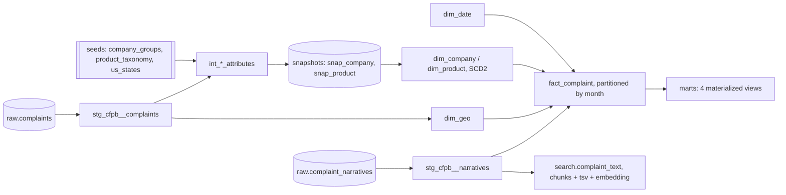

# complaint-warehouse

A PostgreSQL + pgvector warehouse over the CFPB Consumer Complaint Database that supports both analytics and hybrid (keyword + semantic) search.

> Work in progress. I am building this in phases; see `CHANGELOG.md` for what has landed.

## Quickstart (current state)

```bash
cp .env.example .env
make up                       # or: docker compose up -d --build --wait
curl localhost:8000/health    # {"status":"ok", "database": {"postgres": "16.x", "pgvector": "0.8.0"}}
```

Local development:

```bash
python -m venv .venv && source .venv/bin/activate
make install                  # pip install -e ".[dev]" + pre-commit hooks
make lint test
```

## Ingestion

I load from three official CFPB sources. The CFPB stopped publishing consumer narratives on
2026-08-14, so the narratives come from its FOIA archive (see
[ADR 0005](docs/adr/0005-narratives-from-cfpb-foia-archive.md)).

| Command | Source | Lands in |
|---|---|---|
| `make ingest` | Search API, incremental from the watermark (30-day lookback) | `raw.complaints` |
| `make ingest-bulk ARGS="--start 2023-01-01"` | `complaints.csv.zip` backfill | `raw.complaints` |
| `make ingest-narratives ARGS="--start 2025-01-01"` | FOIA Narratives Archive | `raw.complaint_narratives` |
| `make ingest-status` | watermark, row counts, last 10 runs | - |

Every load is idempotent. Rows are upserted by `complaint_id` and only rewritten when a hash
of their business fields changes, so rerunning a load writes nothing.

## Warehouse (dbt)

`make dbt` seeds reference data, takes SCD2 snapshots, builds every model and runs the tests.
`make dbt-docs` serves the lineage graph and column docs on http://localhost:8081.



| Layer | Schema | Models |
|---|---|---|
| Staging | `staging` | `stg_cfpb__complaints`, `stg_cfpb__narratives` (views) |
| Star schema | `warehouse` | `fact_complaint` (monthly range partitions), `dim_company` and `dim_product` (SCD Type 2), `dim_date`, `dim_geo` |
| Search | `search` | `complaint_text`: 200-word overlapping chunks, `tsvector`, `vector(768)` |
| Marts | `marts` | `mv_company_monthly`, `mv_product_monthly`, `mv_state_monthly`, `mv_daily_volume` |

## Repository layout

```
src/complaint_warehouse/   Python package: config, db helpers, ingest/, API (embed/bench in later phases)
db/init/                   SQL run on first Postgres start (extensions + schemas)
dbt/                       dbt project: staging, star schema, search chunks, marts, tests
sql/                       analytics SQL library (phase 6)
bench/                     benchmark harness and labeled query set (phase 6)
docs/                      HLD, LLD, ADRs, runbook, benchmarks
scripts/                   maintenance scripts (CI fixture builder)
tests/                     pytest suite
```

## License

MIT © 2026 Farhan Patel
