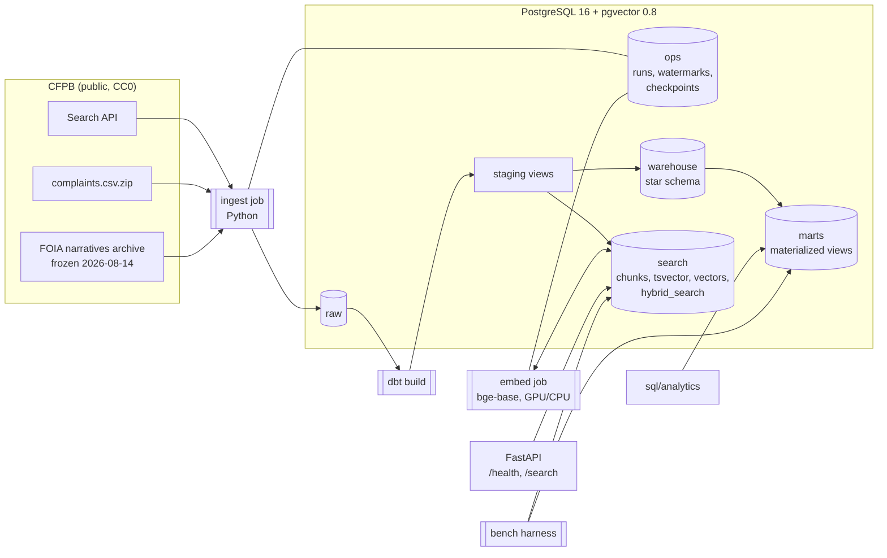

# High-level design

## 1. Purpose

complaint-warehouse turns the public CFPB Consumer Complaint Database (19.2M complaints
since December 2011, 3.85M with a consumer narrative) into one PostgreSQL database that
serves two workloads:

- **Analytics:** a dimensional model and dashboard marts for trend, timeliness, anomaly and
  cohort questions ("which companies' complaint volume spiked last week?").
- **Search:** keyword, semantic and hybrid search over narratives, with the same filters the
  analytics use ("complaints about being charged twice by a credit card company, 2025").

I built it to show the full path from raw public data to a measured, documented system: an
idempotent ingestion job, a tested dbt warehouse, a resumable embedding job, hybrid
retrieval in SQL, and benchmarks that drove the design choices.

## 2. Requirements

| Type | Requirement | How it is met |
|---|---|---|
| Functional | Load all complaints and keep them current daily | Bulk backfill + incremental API with a watermark and a 30-day lookback |
| Functional | Star schema with history for changing attributes | `fact_complaint` + SCD2 `dim_company` / `dim_product` (ADR 0003) |
| Functional | Search narratives by keywords, meaning, or both, with filters | `search.hybrid_search`, exposed at `GET /search` (ADR 0002) |
| Quality | Reruns are safe; crashes lose little work | Idempotent loads, checkpointed embedding, resumable benchmarks |
| Quality | Correct numbers | 91 dbt tests, unknown-member monitoring, labelled search evaluation |
| Performance | Interactive search | Keyword 30–92 ms; filtered hybrid search about 1–1.6 s; unfiltered semantic needs the HNSW index (§7) |
| Constraint | Runs on one laptop from `docker compose up`, no paid services | Postgres 16 + pgvector in Docker; open-source embedding model |

Out of scope: user accounts, a front end, multi-node deployment, and real-time streaming.
The source publishes daily.

## 3. Architecture

### Components

| Component | Responsibility | Runs as |
|---|---|---|
| **Ingest job** (`complaint_warehouse.ingest`) | Download, normalise and upsert CFPB data into `raw`; record runs and watermarks | `make ingest*`, one-off worker container |
| **dbt project** (`dbt/`) | Staging, SCD2 snapshots, star schema, search chunks, marts, tests, docs; installs the search function | `make dbt` |
| **Embed job** (`complaint_warehouse.embed`) | Fill `search.complaint_text.embedding` with `bge-base-en-v1.5` vectors, resumably | `make embed [GPU=1]` |
| **Search function** (`search.hybrid_search`) | Keyword arm + semantic arm + RRF in one inlinable SQL function | Inside Postgres |
| **API** (`complaint_warehouse.api`) | Validate the request, embed the query, call the function, shape the response | `app` container, port 8000 |
| **Analytics library** (`sql/analytics/`) | Five window-function queries over the marts | Ad hoc / BI |
| **Bench harness** (`complaint_warehouse.bench`) | Index study, keyword study, search-quality evaluation, analytics timings | `make bench` |

## 4. Data flow and freshness

1. **Ingest:**
   - The API load re-reads from the watermark minus 30 days, because company responses
     arrive after filing.
   - Every row is hashed. Unchanged rows are skipped, so `last_changed_at` moves only on a
     real change.
2. **dbt:** every model downstream of `raw` is incremental on `last_changed_at` or
   `source_changed_at`.
   - The fact reprocesses only complaints whose source row or narrative changed.
   - The chunk table re-chunks only changed narratives, and new chunks arrive with a NULL
     embedding.
3. **Embed:** processes `embedding IS NULL` chunks only.
4. **Serve:** the marts are refreshed by `dbt build`. Search reads the live tables, so a
   narrative is searchable by keyword as soon as dbt chunks it, and semantically once it is
   embedded.

A routine refresh is `make ingest && make dbt && make embed` (RUNBOOK §2).

## 5. Key design decisions

| Decision | Why | ADR |
|---|---|---|
| One Postgres + pgvector instead of a warehouse plus a vector DB | Filters are joins, not a sync problem; vectors are transactional with their text; one system to run | [0001](adr/0001-postgres-pgvector-over-dedicated-vector-db.md) |
| Hybrid search with RRF in one SQL function | Ranks need no score calibration; filters apply inside each arm; the API, SQL and benchmarks share one code path | [0002](adr/0002-hybrid-search-rrf.md) |
| SCD2 via dbt snapshots over curated seeds | The CFPB renamed its products in 2017 and 2023; my curation changes; history must stay reproducible | [0003](adr/0003-scd-type-2.md) |
| HNSW on `halfvec`, m 32, ef_construction 128, ef_search 200 | Best recall per millisecond on a 500k sample; half the size of float32 | [0004](adr/0004-hnsw-parameters.md) |
| Narratives from the CFPB FOIA archive | The CFPB stopped publishing narratives on 2026-08-14 | [0005](adr/0005-narratives-from-cfpb-foia-archive.md) |
| `bge-base-en-v1.5`, checkpointed batch job | Retrieval-trained, open, fits the GPU; a crash loses at most one batch | [0006](adr/0006-embedding-model-and-batch-job.md) |

Other choices, explained in the LLD:

- the fact is range-partitioned by month (custom dbt materialization);
- surrogate keys are 64-bit hashes;
- missing natural keys get sentinels so joins stay hashable;
- chunks are 200-word windows with a 40-word overlap.

## 6. Non-functional properties

**Scale (current load):**
- 19.17M facts in 180 monthly partitions.
- 5.6M chunks with 768-d vectors.
- 52 GB on disk; the chunk table alone is 32 GB.

**Reliability:**
- **Ingestion:** idempotent per unit. An API window commits with its watermark, a bulk
  batch on its own, an archive file is skipped by SHA-256.
- **Embedding:** the checkpoint commits with the vectors, and a stale-text guard prevents
  an old vector landing on new text.
- **dbt:** `complaint_text` refuses a full refresh, so embeddings cannot be dropped by
  accident.
- **API:** a 30 s statement timeout maps to HTTP 504 with a hint, and `/health` reports
  503 when the database is unreachable.

**Correctness checks:**
- **dbt tests:** unique, not-null, relationships, accepted values, row-count parity between
  staging and the fact, unknown members under 0.1%, and SCD2 windows with no gaps or
  overlaps.
- **CI:** builds the whole pipeline on a real CFPB fixture sample, runs dbt twice (full,
  then incremental), and runs end-to-end search tests with the real model.

**Security and privacy:**
- The data is public and already de-identified by the CFPB.
- Credentials come from `.env`. The defaults (`cw` / `cw`) are for local use only.
- Compose publishes Postgres on host port 5433 on all interfaces, which is fine on a
  laptop. Anywhere else I would bind it to `127.0.0.1` and use a real password.
- No complaint text leaves the machine: embeddings are computed locally.

**Observability:**
- `ops.load_runs` records every job run.
- `pg_stat_statements` is enabled.
- dbt source freshness checks `raw.complaints`.
- `/health` reports the Postgres and pgvector versions.

## 7. Known limitations

- **No full-corpus vector index yet.** The HNSW parameters are chosen, but the build needs
  an estimated 9–10 GB of memory, more than the 7.4 GB Docker VM. Until it is built, an
  unfiltered semantic or hybrid search takes an exact scan of 86–119 s and returns 504.
  Filtered searches and keyword search are interactive.
- **Narratives end at 2026-08-14.** Newer complaints are analysed but not text-searchable.
- **Search quality is measured on topic labels.** This favours semantic search, and exact
  term matching is not evaluated (BENCHMARKS §3).
- **`timely_flag` is as published.** The CFPB marks in-progress complaints timely, so the
  marts compute rates over responded complaints (DATA_DICTIONARY note 1).

## 8. Future work

1. Build the full-corpus HNSW index on a machine with about 16 GB for Postgres, restore it,
   re-measure recall at 5.6M, and switch the semantic arm to the `halfvec` expression.
2. Evaluate `hnsw.iterative_scan` (pgvector 0.8) for broad filters instead of the exact
   filtered path.
3. Add an exact-term query set (company names, statutes, product names) to measure what
   the keyword arm adds.
4. A cross-encoder reranker over the fused top 50, measured with the same harness.
5. Schedule the refresh (cron or Airflow) and alert on freshness and failed runs.
